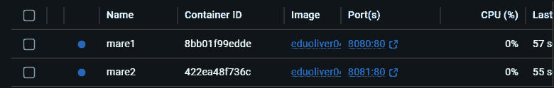

# Maré — Receitas de Frutos do Mar

> Projeto evoluído ao longo do Bootcamp II: Etapa 01 (frontend + API pública), Etapa 02 (persistência real + Docker) e Etapa 03 (trabalho em grupo com fluxo de PR, revisão e CI).

## Integrantes (Etapa 03)

| Nome | Matrícula | GitHub | Funcionalidade | PR principal |
|---|---|---|---|---|
| Eduardo Gabriel de Oliveira Santos | 22505511 | [@Eduoliver04](https://github.com/Eduoliver04) | Frontend, busca/exibição de receitas, persistência (Supabase), CRUD de favoritos, extração das funções compartilhadas em `utils.js` | [#1 — Extrai utils.js compartilhado](https://github.com/Eduoliver04/mare-frutos-do-mar/pull/1) |
| Leonardo Jiahao Lin Chen | 22510052 | [@leonardojiahao-bit](https://github.com/leonardojiahao-bit) | Testes automatizados (Jest), GitHub Actions (CI), Docker Hub | [#2 — Adiciona testes automatizados e workflow de CI](https://github.com/Eduoliver04/mare-frutos-do-mar/pull/2) |

Cada PR foi revisada e aprovada pelo outro integrante antes do merge: a #1 foi revisada por Leonardo e a #2 por Eduardo.

## Descrição
Aplicação web que permite buscar receitas por nome ou explorar um catálogo de receitas de frutos do mar de diversas culinárias do mundo, exibindo ingredientes, modo de preparo e origem de cada prato. Permite salvar receitas como favoritas, com uma anotação pessoal, em um banco de dados real.

## API utilizada
- **TheMealDB** — [documentação](https://www.themealdb.com/api.php)
- Endpoints consumidos:
  - `GET /search.php?s={termo}` — busca receitas pelo nome
  - `GET /filter.php?c=Seafood` — lista receitas da categoria "Seafood" (frutos do mar)
  - `GET /lookup.php?i={id}` — detalhes completos de uma receita (ingredientes, modo de preparo, categoria, origem)
- Os textos retornados pela API (em inglês) são traduzidos para português no próprio navegador, usando o endpoint público do Google Tradutor, em lotes.

## Funcionalidades
- Buscar receitas digitando um termo (ex.: "shrimp", "salmon", "fish") e ver os resultados em cartões.
- Explorar automaticamente um catálogo de receitas de frutos do mar com um clique.
- Clicar em qualquer receita para ver detalhes: imagem, categoria, origem, lista de ingredientes com medidas e modo de preparo.
- **Favoritar uma receita com uma anotação pessoal**, listar os favoritos salvos e removê-los — tudo persistido em um banco de dados real (sobrevive ao fechar o navegador).
- Mensagens amigáveis quando a busca não retorna resultados ou quando a API está indisponível.

## Estrutura do projeto

| Arquivo | Papel |
|---|---|
| `index.html` | Página da aplicação; carrega `utils.js` antes de `script.js` |
| `style.css` | Estilos |
| `script.js` | Lógica da interface: busca, catálogo, modal de detalhes e CRUD de favoritos |
| `utils.js` | Funções puras compartilhadas (`validarTermoBusca`, `listarIngredientes`, `formatarRotuloFavorito`), usadas no navegador via `window.MareUtils` e nos testes via `module.exports` |
| `utils.test.js` | Testes automatizados (Jest) das funções de `utils.js` |
| `package.json` | Dependência de desenvolvimento (Jest) e script `npm test` |
| `.github/workflows/ci.yml` | Workflow do GitHub Actions que roda os testes |
| `Dockerfile` / `.dockerignore` | Empacotamento da aplicação com Nginx |

## Persistência de dados
- **Banco:** Supabase (PostgreSQL).
- **Tabela `favoritos`:**

  | coluna | tipo | descrição |
  |---|---|---|
  | `id` | `int8` (identity) | chave primária |
  | `criado_em` | `timestamptz`, default `now()` | data de criação |
  | `nome_item` | `text` | nome (traduzido) da receita favoritada |
  | `dados_extra` | `jsonb` | `{ "nota": "...", "idMeal": "...", "imagem": "..." }` — anotação pessoal, id da receita na TheMealDB e url da foto |

- **CRUD implementado:** criar (favoritar), listar (seção "Meus favoritos", carregada ao abrir a página) e excluir (botão "×" em cada favorito). Edição (update) também está implementada: favoritar a mesma receita novamente com uma nota diferente atualiza a anotação.
- **Limitação conhecida:** as políticas de RLS da tabela `favoritos` estão abertas para o papel `anon` (leitura, escrita e exclusão livres), conforme sugerido no enunciado. Aceitável para este exercício, mas não para produção.

## Fluxo de colaboração (Etapa 03)
- A branch `main` é protegida por uma regra que exige:
  - Pull Request para qualquer mudança (nada é enviado direto para a `main`);
  - pelo menos 1 aprovação de outro integrante;
  - o check **`testes`** do GitHub Actions passando.
- Padrão de nome de branch: `feature/nome-da-funcionalidade` (ex.: `feature/utils-compartilhados`, `feature/testes-ci`); ajustes de documentação usam `docs/...`.
- Toda PR tem título claro, descrição (o que foi feito / por que / como testar) e um revisor designado, que comenta antes de aprovar.

## Testes automatizados
- **Framework:** [Jest](https://jestjs.io/) 29, rodando em Node.js 20.
- **O que é testado** (`utils.test.js`, 4 testes):
  - `validarTermoBusca` rejeita termos vazios ou só com espaços;
  - `validarTermoBusca` aceita um termo válido;
  - `listarIngredientes` lista só os ingredientes preenchidos, com a medida quando houver;
  - `formatarRotuloFavorito` monta o rótulo com e sem anotação, e usa "Receita sem nome" quando o nome está vazio.
- **Como rodar localmente:**
  ```
  npm install
  npm test
  ```
- **CI:** o workflow `.github/workflows/ci.yml` ("CI - Testes") roda `npm install` e `npm test` a cada Pull Request e a cada push na `main`. O job se chama `testes` e é um check obrigatório para o merge.

## Evidências
- **PR bloqueada pelo CI ("teste de fogo"):** a [PR #4](https://github.com/Eduoliver04/mare-frutos-do-mar/pull/4) inverte de propósito a expectativa de um teste em `utils.test.js`. O check obrigatório `testes` falhou ([execução do CI](https://github.com/Eduoliver04/mare-frutos-do-mar/actions/runs/39659767814/job/119429421312)) e o GitHub bloqueou o merge ("All checks have failed" / "Merging is blocked"). A PR fica aberta, sem merge, apenas como evidência.
- **Conflito de merge:** não houve conflito durante a Etapa 03. As duas branches (`feature/utils-compartilhados` e `feature/testes-ci`) adicionaram o arquivo `utils.js` com conteúdo idêntico, então o Git combinou as duas versões automaticamente no merge da PR #1, depois que a PR #2 já tinha entrado na `main`.

## Empacotamento com Docker
A aplicação é servida por um Nginx dentro de um container Docker. A imagem inclui `index.html`, `style.css`, `script.js` e `utils.js`.

```
docker run -d -p 8080:80 eduoliver04/mare-frutos-do-mar:latest
```

Depois, abra **http://localhost:8080**.

### Sidequests (Etapa 02)
- **SQ1 — `.dockerignore`:** exclui `.git`, `README.md`, `Dockerfile`, `node_modules` e arquivos de log/rascunho da imagem. Isso deixa a imagem menor (menos camadas e bytes copiados) e o build mais rápido, já que o Docker não precisa processar arquivos que a aplicação não usa em tempo de execução.
- **SQ2 — versionamento:** publicadas no [Docker Hub](https://hub.docker.com/r/eduoliver04/mare-frutos-do-mar/tags) as tags `1.0` (versão do fim da Etapa 02), `1.1` e `latest` (versão atual, com `utils.js` e favoritos conectados ao Supabase).
- **SQ3 — overview do Docker Hub:** preenchido com descrição, o comando `docker run` e o link do repositório GitHub.
- **SQ4 — dois containers simultâneos:** dois containers da mesma imagem (`mare1` e `mare2`) rodando ao mesmo tempo, nas portas 8080 e 8081 (print do Docker Desktop):

  

  **Se eu tivesse 100 containers, como gerenciaria?** Rodar e atualizar 100 containers manualmente com `docker run`/`docker stop` um por um não escala: não há como distribuir carga entre eles, substituir automaticamente um que caiu, ou atualizar a versão sem downtime. É exatamente esse problema que o **Kubernetes** resolve: ele organiza containers em **Pods** (a menor unidade executável, um ou mais containers que sempre rodam juntos), agrupa Pods idênticos em um **Deployment** com um número desejado de **réplicas**, e distribui esses Pods entre as máquinas de um **cluster** (um conjunto de servidores gerenciados como um só). Se um Pod falha, o Kubernetes cria outro automaticamente para manter o número de réplicas; se a demanda cresce, basta aumentar o número de réplicas (ou configurar autoscaling) e o cluster se reorganiza para acomodar. Ou seja: em vez de eu gerenciar 100 containers um a um, eu descrevo o estado desejado (esta imagem, estas réplicas, estes recursos) e o Kubernetes cuida de manter esse estado — é a ponte entre "rodar um container" e "operar um sistema em produção".

## Como executar localmente
1. Clone: `git clone https://github.com/Eduoliver04/mare-frutos-do-mar.git`
2. Abra o arquivo `index.html` no navegador (ou use a extensão Live Server do VS Code).

   **Ou, via Docker:**
   ```
   docker build -t mare-frutos-do-mar .
   docker run -d -p 8080:80 mare-frutos-do-mar
   ```
   Depois abra http://localhost:8080.
3. Para rodar os testes: `npm install && npm test` (requer Node.js).

## Links
- **Aplicação no ar (GitHub Pages):** https://eduoliver04.github.io/mare-frutos-do-mar/
- **Repositório:** https://github.com/Eduoliver04/mare-frutos-do-mar
- **Pull Requests da Etapa 03:** https://github.com/Eduoliver04/mare-frutos-do-mar/pulls?q=is%3Apr
- **Execuções do CI (GitHub Actions):** https://github.com/Eduoliver04/mare-frutos-do-mar/actions
- **Imagem no Docker Hub:** https://hub.docker.com/r/eduoliver04/mare-frutos-do-mar
